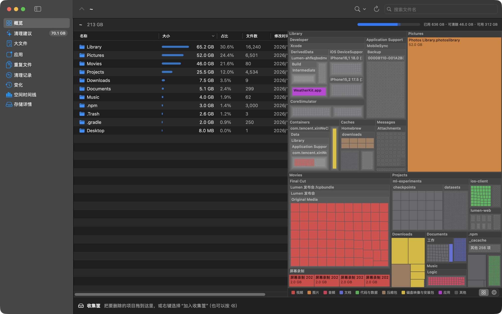

# DiskLens

**English** · [中文](README.zh-CN.md)

See what is filling your Mac, then decide what goes. DiskLens is a free, native macOS disk space analyzer. Your scan results stay on your Mac, and you don't need an account.

## What it does

- **See where space went:** a folder list, treemap and sunburst, kept in sync, with search and a list of the largest files.
- **Clean up safely:** suggestions sorted by risk, duplicate file search, and a basket that shows how much space you would really get back.
- **Find similar photos:** compressed copies, resized versions and bursts, shown side by side so you choose what stays.
- **Understand System Data:** the same categories as System Settings, with System Data broken into its largest parts.
- **Uninstall apps fully:** find what an app left behind, including after you drag it to the Trash.
- **Clear developer caches:** Xcode, simulators and other developer tools.
- **Track changes:** what grew since the last scan, a timeline of used space, and which apps write the most.
- **Stay informed:** free space in the menu bar and an alert when space runs low.

## Install

You need macOS 14 or later, on Apple silicon or Intel.

1. Download the latest `DiskLens-x.y.z.zip` from [Releases](https://github.com/calabli/DiskLens/releases).
2. Unzip it and move `DiskLens.app` to Applications.
3. Open it. **macOS will stop it the first time**, because DiskLens is not yet notarized by Apple.
4. Open **System Settings › Privacy & Security**, scroll to Security, and click **Open Anyway** next to DiskLens. Confirm, then open it again.

### Full Disk Access

DiskLens works without this, but macOS hides Mail, Messages, the Trash and other apps' data from it, so totals come out low. On first launch, a guide walks you through turning it on. See [what DiskLens does with that access](PRIVACY.md).

The preview builds are not signed with a developer certificate, so macOS may ask for this permission again after an update.

## Is it safe?

- Nothing is deleted until you confirm, and files you remove go to the Trash, so you can put them back until you empty it.
- Developer tool cleanups are the exception: they run that tool's own command, and what they remove doesn't go to the Trash.
- Cleanup suggestions are labelled by risk. Read the review tier before you remove anything from it.
- DiskLens is in preview and has mainly been tested on one Mac. Back up anything important, and [open an issue](https://github.com/calabli/DiskLens/issues) if a suggestion looks wrong.

## Uninstall

Move `DiskLens.app` to the Trash. If you turned on background recording, turn it off first. To remove its data too, delete these folders:

- `~/Library/Caches/app.disklens.DiskLens`
- `~/Library/Application Support/app.disklens.DiskLens`

## More

- [Privacy](PRIVACY.md)
- [Architecture and building from source](ARCHITECTURE.md)
- [MIT License](LICENSE)
