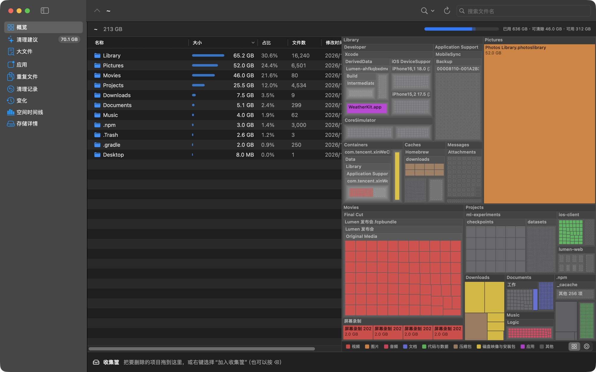

# DiskLens

[English](README.md) · **中文**

看清 Mac 的空间都去哪了，再由你决定删什么。DiskLens 是一款免费的原生 macOS 磁盘分析工具，扫描结果只留在你的 Mac 上，也不需要账号。

## 能做什么

- **看清空间去向**：文件夹列表、树状图和旭日图联动，还能搜索和查看最大的文件。
- **放心清理**：按风险分级的清理建议、重复文件查找，收集筐会显示实际能释放多少空间。
- **查找相似照片**：压缩过的副本、改过尺寸的版本和连拍，并排显示，由你决定留哪张。
- **看懂系统数据**：按系统设置的分类显示，并把系统数据拆成几个最大的部分。
- **彻底卸载应用**：找出应用留下的文件，把应用拖进废纸篓后也能提醒你。
- **清理开发缓存**：Xcode、模拟器和其他开发工具。
- **追踪变化**：对比上次扫描的增长，查看已用空间时间线，以及哪些应用写入最多。
- **随时掌握**：在菜单栏显示可用空间，空间不足时提醒。

## 安装

需要 macOS 14 或更高版本，支持 Apple 芯片和 Intel。

1. 从 [Releases](https://github.com/calabli/DiskLens/releases) 下载最新的 `DiskLens-x.y.z.zip`。
2. 解压后把 `DiskLens.app` 移到“应用程序”。
3. 打开它。**第 1 次打开时 macOS 会拦下来**，因为 DiskLens 还没有通过 Apple 公证。
4. 打开**系统设置 › 隐私与安全性**，滚动到“安全性”，点 DiskLens 旁边的**仍要打开**。确认后再打开一次。

### 完全磁盘访问权限

不开也能用，但 macOS 不让 DiskLens 读取邮件、信息、废纸篓和其他应用的数据，算出来的结果会偏小。第 1 次打开时会有引导带你开启。可以看看 [DiskLens 怎么使用这个权限](PRIVACY.md)。

预览版没有开发者证书签名，所以更新后 macOS 可能会再次要求开启这个权限。

## 安全吗

- 你确认之前不会删除任何东西。删除的文件会进废纸篓，清空之前都能放回原处。
- 开发工具的清理是例外：它运行的是工具自己的命令，删掉的东西不进废纸篓。
- 清理建议都标了风险。“需要检查”这一级，请看过再删。
- DiskLens 还在预览阶段，主要在一台 Mac 上测试过。重要资料请先备份。如果发现建议不对，请[提交 Issue](https://github.com/calabli/DiskLens/issues)。

## 卸载

把 `DiskLens.app` 移到废纸篓。如果开启过后台记录，请先关闭。要连数据一起删除，再删掉这两个文件夹：

- `~/Library/Caches/app.disklens.DiskLens`
- `~/Library/Application Support/app.disklens.DiskLens`

## 更多

- [隐私说明](PRIVACY.md)
- [架构和从源码构建](ARCHITECTURE.md)（英文）
- [MIT 许可证](LICENSE)
